# Абсолютная и относительная погрешность. Округление и накопление ошибки

## Блок 1. Абсолютная и относительная погрешность

### Задача 1. Ручной счёт

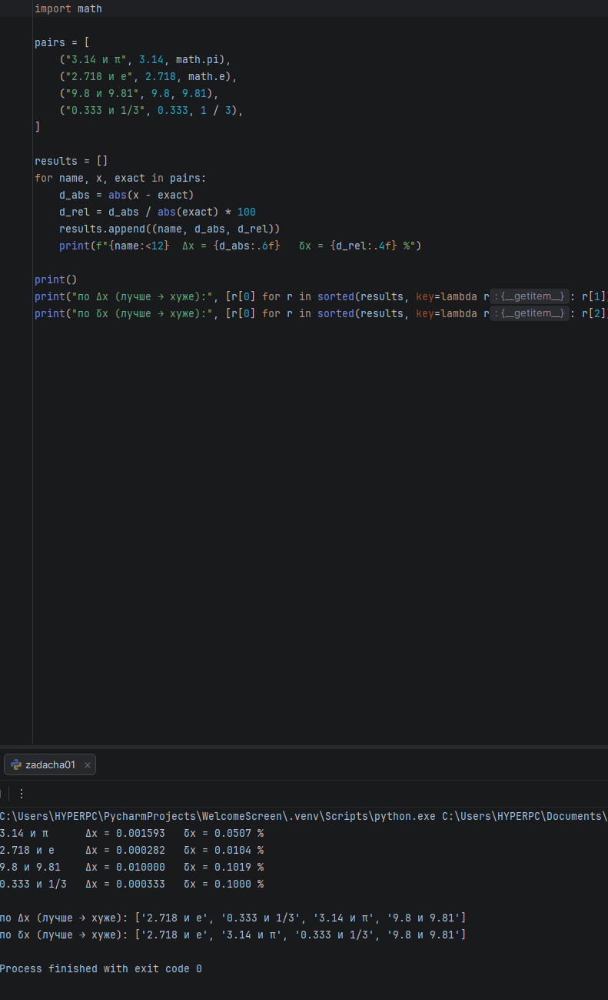

**Вывод.** По Δx порядок такой: e, 1/3, π, g; по δx — e, π, 1/3, g. Порядки не совпадают: у π абсолютная ошибка больше, чем у 1/3 (0.0016 против 0.0003), но само число π примерно в 10 раз больше, поэтому относительная ошибка у него меньше (0.05 % против 0.1 %). Абсолютная погрешность не учитывает масштаб величины, а относительная учитывает.

### Задача 2. Сравнение несопоставимых величин

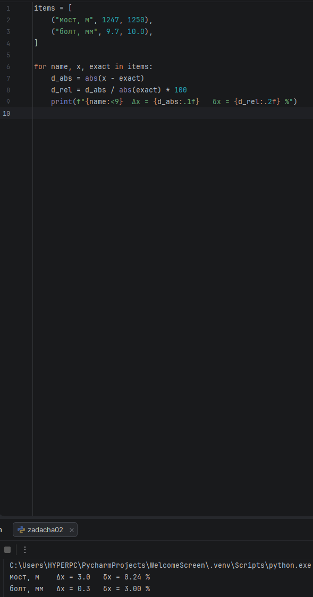

**Вывод.** По абсолютной погрешности сильнее ошибся мост (3 м против 0.3 мм), по относительной — болт (3 % против 0.24 %, в 12 раз хуже). Абсолютные погрешности в разных единицах и разного масштаба сравнивать нельзя, поэтому качество измерения показывает относительная погрешность: болт измерен хуже.

### Задача 3. Функция relative_error

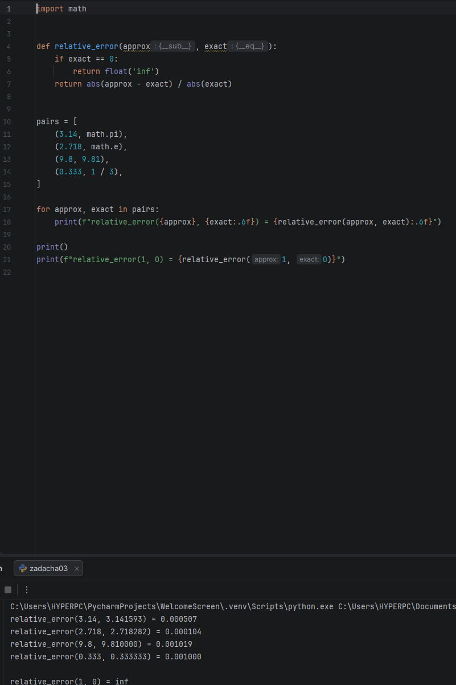

**Вывод.** Функция даёт те же значения, что и в задаче 1, только в долях, а не в процентах. При `exact == 0` она возвращает `inf` и не падает с `ZeroDivisionError`.

### Задача 4. Обратная задача

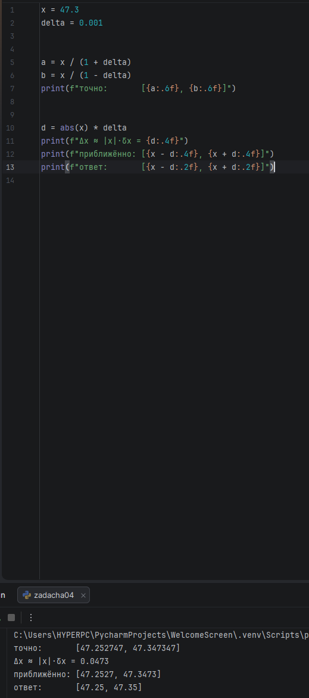

**Вывод.** x\* ∈ [47.25, 47.35]. Точное решение неравенства [47.2527, 47.3473] совпадает с оценкой Δx ≈ |x|·δx = 0.0473 до 4 знаков. Погрешность в сотых, поэтому границы записаны до сотых.

### Задача 5. Порог по абсолютной и относительной ошибке

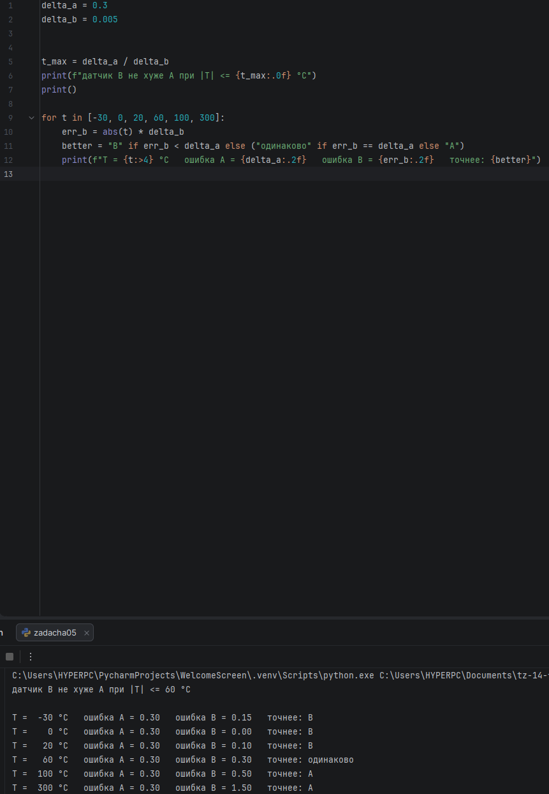

**Вывод.** Из |T|·0.005 ≤ 0.3 получаем |T| ≤ 60 °C: в этом диапазоне датчик B не хуже A, а при |T| > 60 °C точнее A. Ошибка B растёт вместе с температурой, а у A она постоянная, поэтому для измерений около нуля выгоднее B, а для высоких температур — A.

---

## Блок 2. Значащие цифры и округление

### Задача 6. Подсчёт значащих цифр

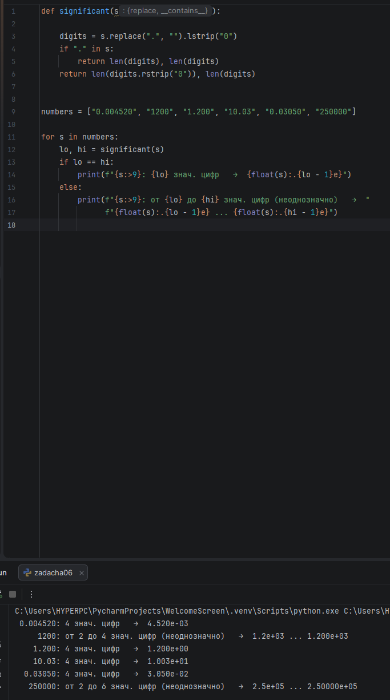

**Вывод.** Неоднозначны 1200 (от 2 до 4 значащих цифр) и 250000 (от 2 до 6). Нули справа без запятой могут быть как измеренными цифрами, так и просто «держателями» разряда. Экспоненциальная запись (`1.2e+03` или `1.200e+03`) прямо показывает, сколько цифр значащих.

### Задача 7. Честная запись результата

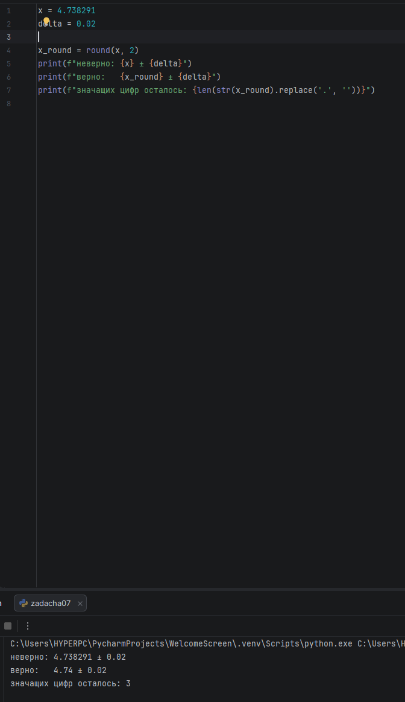

**Вывод.** Правильная запись: 4.74 ± 0.02, осталось 3 значащие цифры. Запись 4.738291 ± 0.02 неверна, потому что цифры после сотых не определены: погрешность уже в сотых, и такая запись выдаёт ложную точность.

### Задача 8. Округление и banker's rounding

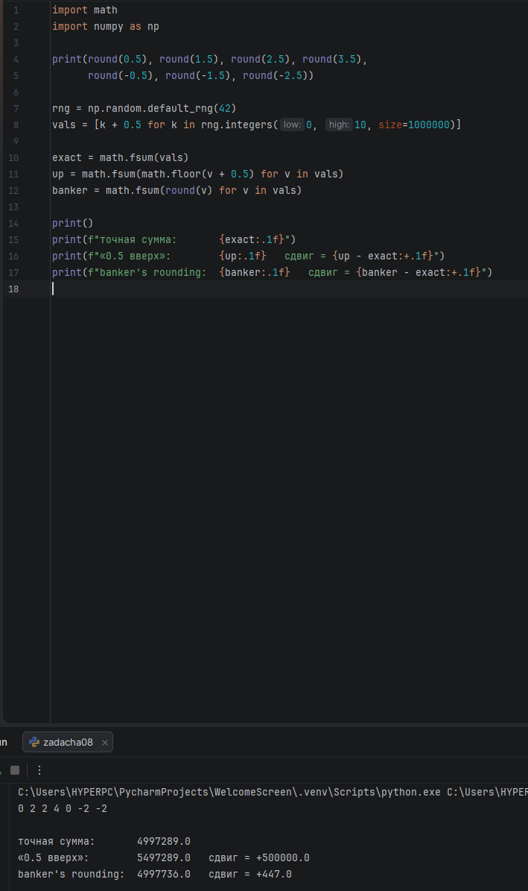

**Вывод.** `round()` в Python округляет половину к чётному: 0.5 → 0, 2.5 → 2, −2.5 → −2. Поэтому результат отличается от «школьного» правила. При «0.5 вверх» каждое из 10^6 чисел сдвигается на +0.5, и сумма уезжает на **+500 000**, а при banker's rounding сдвиг всего +447 (за счёт случайного перевеса нечётных k). В финансах такой систематический сдвиг — это реальные деньги, которые «уезжают» в одну сторону.

### Задача 9. Промежуточное округление

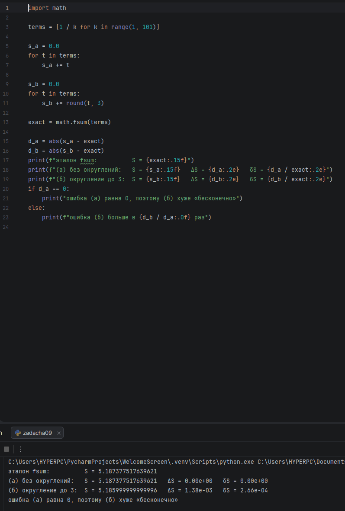

**Вывод.** Вариант (а) без округлений совпал с эталоном `fsum` точно (ΔS = 0), а вариант (б) ошибся на ΔS ≈ 1.4·10⁻³ (δS ≈ 0.03 %). Посчитать «во сколько раз» нельзя, потому что ошибка (а) равна нулю. Правило: округлять только в самом конце, а не в середине цепочки.

---

## Блок 3. Накопление ошибки и float-эксперименты

### Задача 10. Классика 0.1 + 0.2

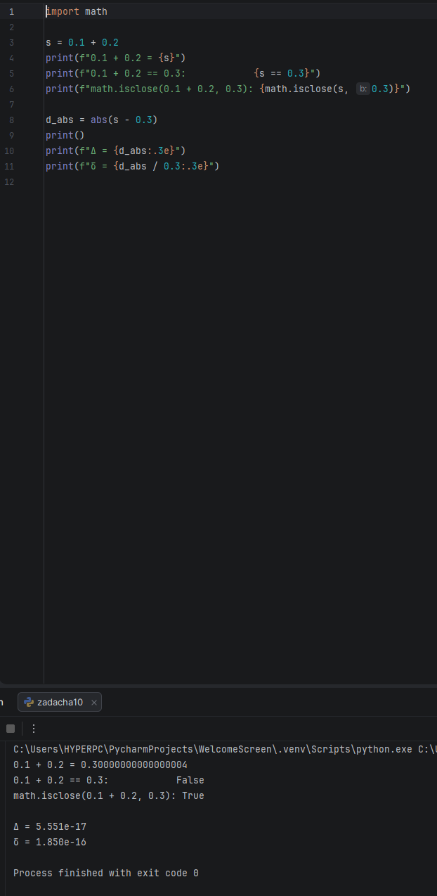

**Вывод.** `0.1 + 0.2 == 0.3` даёт `False`, а `math.isclose` — `True`; Δ ≈ 5.6·10⁻¹⁷, δ ≈ 1.9·10⁻¹⁶.

Почему 0.1 не представимо точно: компьютер хранит числа в двоичной системе, а 0.1 в ней записывается бесконечной дробью, так же как 1/3 = 0.333… в десятичной. Хранить бесконечно много цифр нельзя, поэтому дробь обрезается, и в памяти лежит не 0.1, а очень близкое к нему число. При сложении двух таких приближений ошибки складываются, и в последних цифрах появляется «шум».

### Задача 11. Катастрофическая потеря точности

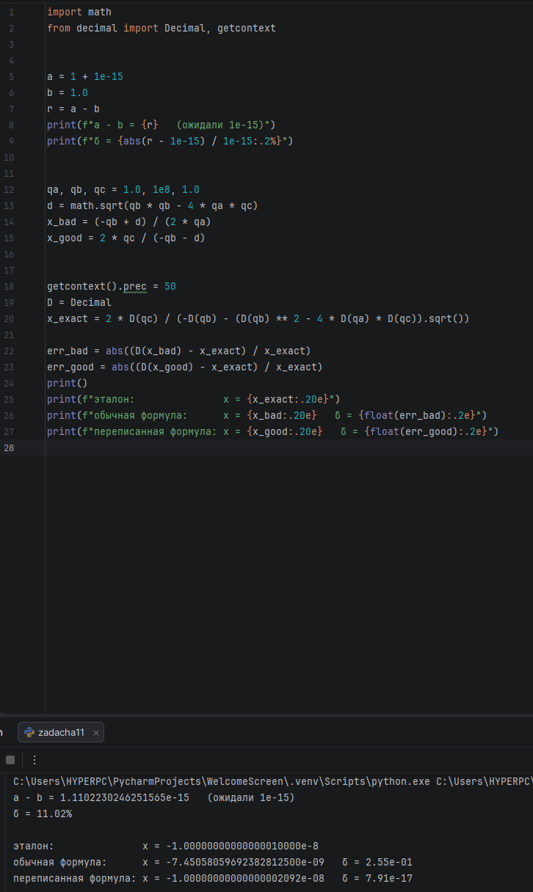

**Вывод.** Вместо 10⁻¹⁵ получилось 1.11·10⁻¹⁵, относительная погрешность 11 %. Старшие разряды близких чисел взаимно уничтожились, и остался шум младших. Для уравнения x² + 10⁸x + 1 = 0 обычная формула даёт меньший корень с ошибкой 25 %, а переписанная через 2c / (−b − √(b² − 4ac)) — с ошибкой около 10⁻¹⁶, то есть на 15 порядков точнее.

### Задача 12. Накопление в цикле — сравнение стратегий

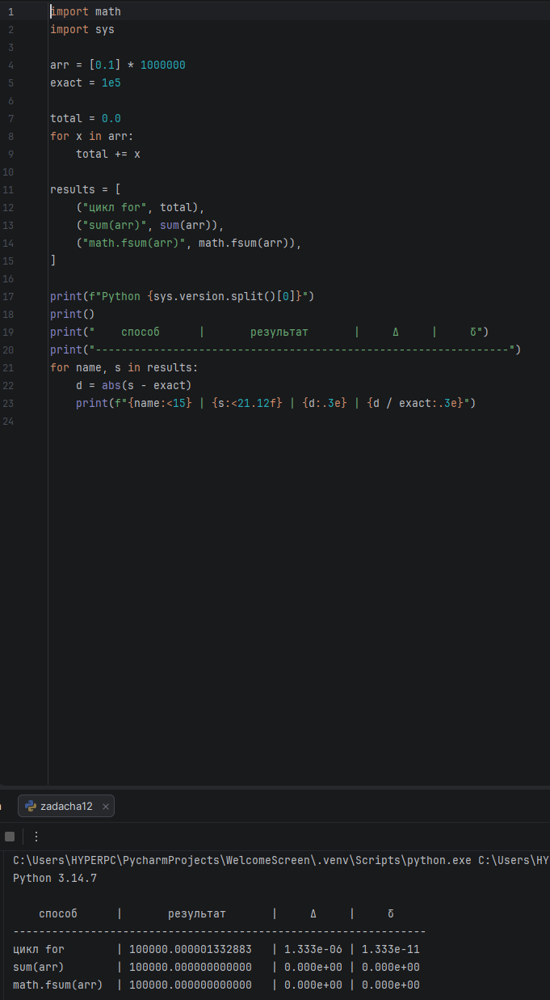

**Вывод.** Наивный цикл ошибся на Δ ≈ 1.3·10⁻⁶ (δ ≈ 1.3·10⁻¹¹), а `sum` и `math.fsum` дали ровно 100000. Сравнить «во сколько раз» нельзя: у `sum` и `fsum` ошибка равна нулю. Результат `sum` зависит от версии Python, поэтому версия выведена в первой строке (запуск на 3.14.7). Самый надёжный способ — `math.fsum`.

### Задача 13. Суммирование в правильном порядке

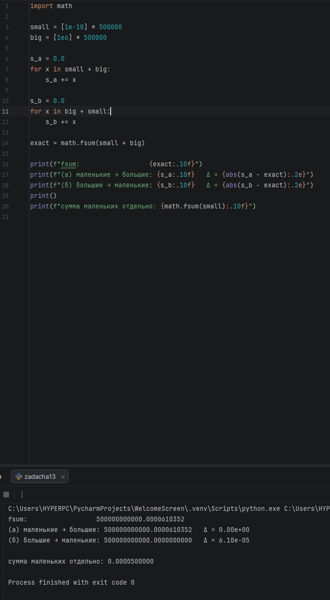

**Вывод.** Порядок «маленькие → большие» совпал с `fsum`, а «большие → маленькие» потерял все маленькие слагаемые (Δ ≈ 6·10⁻⁵, это и есть их сумма 5·10⁻⁵ после округления). Маленькое число, прибавленное к 5·10¹¹, не помещается в разрядную сетку и пропадает. Поэтому складывать нужно от маленьких к большим или через `math.fsum`.

### Задача 14. Детектор накопления погрешности

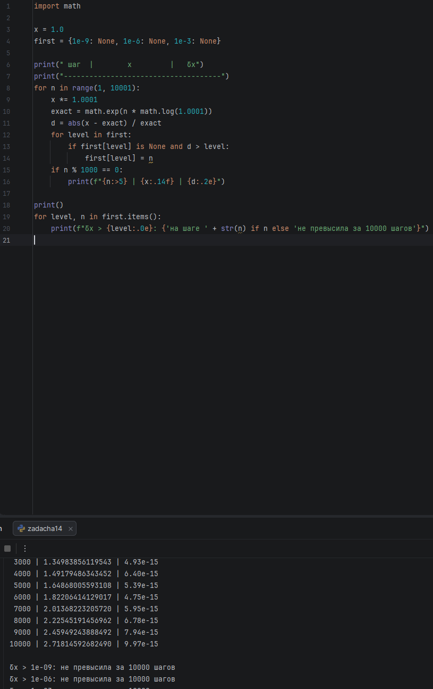

**Вывод.** По таблице видно, что относительная погрешность растёт с номером шага, хоть и неравномерно: от 1.6·10⁻¹⁵ на 1000-м шаге до 10⁻¹⁴ на 10 000-м. Порогов 10⁻⁹, 10⁻⁶ и 10⁻³ она за 10 000 шагов не достигла. Каждое умножение добавляет маленькую ошибку, и в мультипликативном процессе они накапливаются, но при 10 000 шагах это только около сотни машинных эпсилон.

### Задача 15. Финансы: float vs Decimal

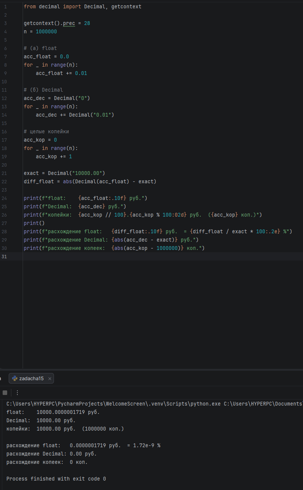

**Вывод.** float дал 10000.0000001719 руб.: расхождение 1.7·10⁻⁷ руб., или 1.7·10⁻⁹ %. Decimal и целые копейки дали ровно 10000.00 руб., и правильный с точки зрения бухгалтерии результат именно этот. В float 0.01 не представимо точно, и ошибка накапливается с каждой операцией, а в бухгалтерии не должно теряться ни копейки. Поэтому деньги считают в `Decimal` или в целых копейках.
