# Устойчивость алгоритма и корректная постановка эксперимента

Эталон во всех экспериментах — `mpmath` с 50 знаками. Где в задании просят график, вместо него таблица с колонками `lg` (log-log).

## Блок 1. Обусловленность задачи

### Задача 1. Число обусловленности вручную

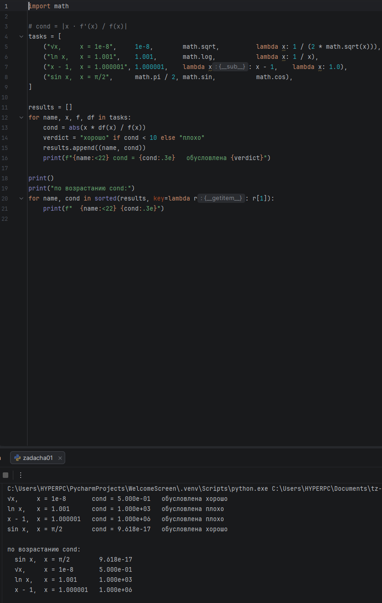

| Функция | cond = \|x·f'/f\| | Итог |
|---|---|---|
| sin x, x = π/2 | x·cos x / sin x ≈ 0 (1e-16) | хорошо |
| √x, x = 10⁻⁸ | x·(1/2√x)/√x = 0.5 | хорошо |
| ln x, x = 1.001 | 1 / ln x ≈ 1000 | плохо |
| x − 1, x = 1.000001 | x / (x − 1) ≈ 10⁶ | плохо |

**Вывод.** По возрастанию: sin x, √x, ln x, x − 1. Самая «опасная» задача — x − 1 около единицы (cond ≈ 10⁶): это вычитание близких чисел, и относительная ошибка входа усиливается в миллион раз. ln x около 1 опасен по той же причине, потому что ln x ≈ x − 1.

### Задача 2. Вычитание близких чисел

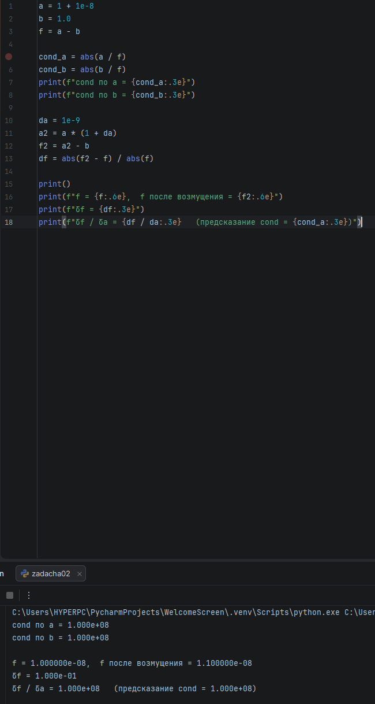

**Вывод.** Аналитически cond по a = |a/(a − b)|, по b = |b/(a − b)|: при a ≈ b знаменатель стремится к нулю, и оба числа огромны. Здесь cond = 10⁸. Численно: при относительном возмущении a на δa = 10⁻⁹ результат изменился на δf = 0.1, и δf/δa = 10⁸ — ровно как предсказывает cond. Маленькая ошибка во входе превращается в 10 % ошибки в ответе.

### Задача 3. Кратные корни

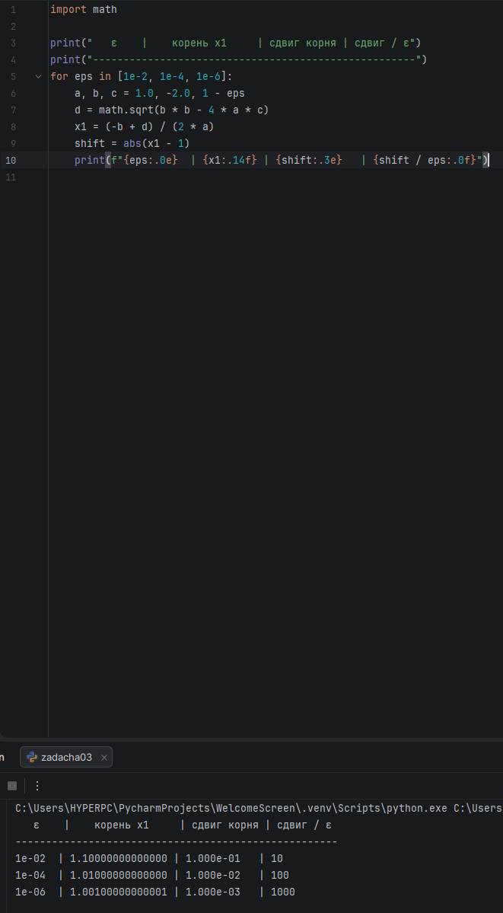

**Вывод.** Корни возмущённого уравнения 1 ± √ε: при ε = 10⁻², 10⁻⁴, 10⁻⁶ корень сдвигается на 0.1, 0.01, 0.001. Отношение сдвиг/ε равно 10, 100, 1000 и растёт как 1/√ε. Кратный корень плохо обусловлен: возмущение коэффициента ε сдвигает корень на √ε, что намного больше самого ε.

### Задача 4. Обусловленность vs устойчивость

Пример: длина вектора r = √(x² + y²) при x = y.

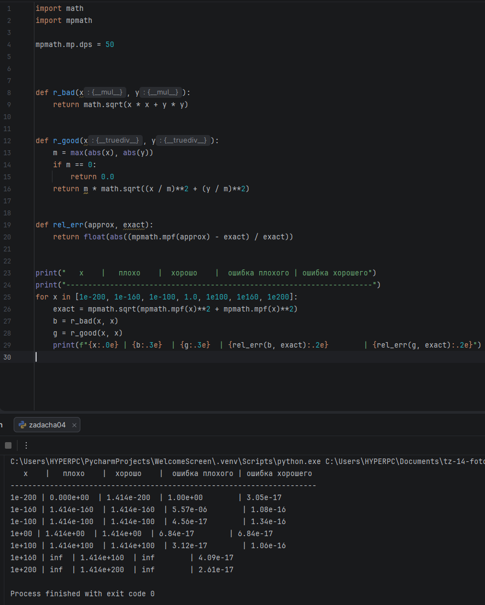

**Вывод.**
- **Задача** обусловлена хорошо (cond = 1): относительная ошибка в x даёт такую же относительную ошибку в r.
- **Алгоритм** «в лоб» неустойчив: x·x при x ≥ 10¹⁶⁰ переполняется в `inf`, а при x ≤ 10⁻²⁰⁰ обнуляется, хотя ответ (1.414·x) прекрасно представим. Версия с масштабированием на max(|x|, |y|) даёт ошибку около 10⁻¹⁶ на всём диапазоне от 10⁻²⁰⁰ до 10²⁰⁰.

---

## Блок 2. Устойчивость алгоритма

### Задача 5. Квадратное уравнение

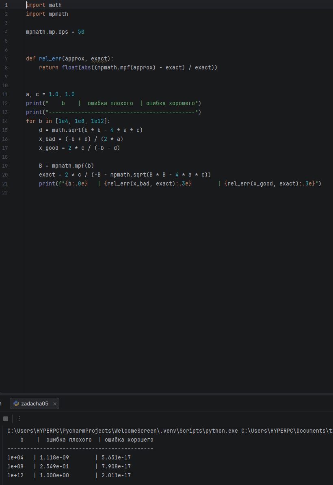

**Вывод.** При b = 10⁴ плохой способ ошибается на 10⁻⁹, при b = 10⁸ — на 25 %, при b = 10¹² — на 100 %. Хороший способ на всех b даёт ошибку около 10⁻¹⁶. Катастрофа начинается при b ≈ 10⁸, когда b² ≫ 4ac и √(b² − 4ac) почти равен b.

### Задача 6. (1 − cos x) / x²

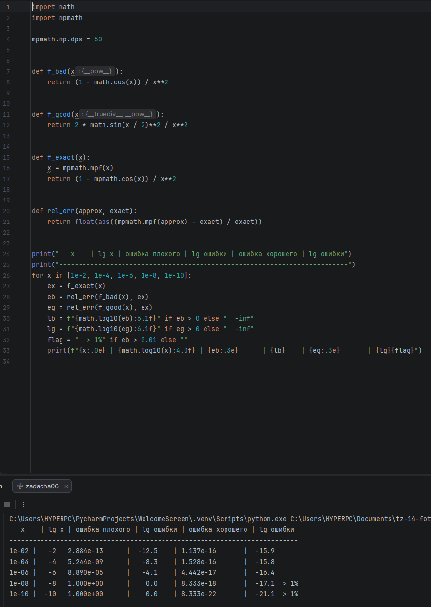

**Вывод.** Ошибка плохого способа растёт с уменьшением x примерно на 4 порядка на каждые 2 порядка x, и **больше 1 % она становится при x = 10⁻⁸** (там cos x в float равен ровно 1, и результат 0). Хороший способ через 2·sin²(x/2) точен на всех x. Правило: если в формуле есть 1 − cos x, 1 − sin x и подобное при значениях, где функция близка к 1, нужно искать тождество, которое убирает вычитание.

### Задача 7. √(x+1) − √x

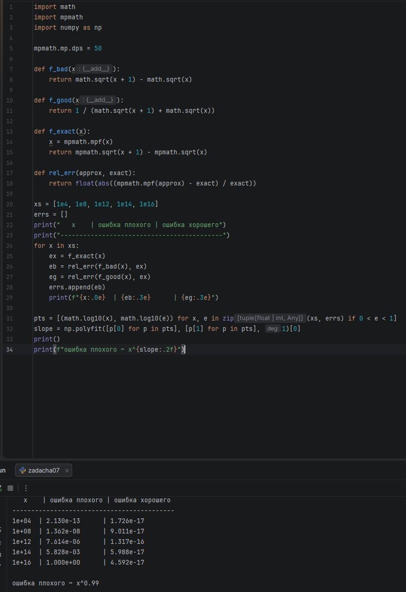

**Вывод.** Ошибка плохого способа растёт как x¹ (оценка наклона по точкам — 0.99): от 10⁻¹³ при x = 10⁴ до 100 % при x = 10¹⁶, где x + 1 == x в float. Хороший способ (умножение на сопряжённое) точен до 10⁻¹⁶ на всём диапазоне.

### Задача 8. ln(1 + x)

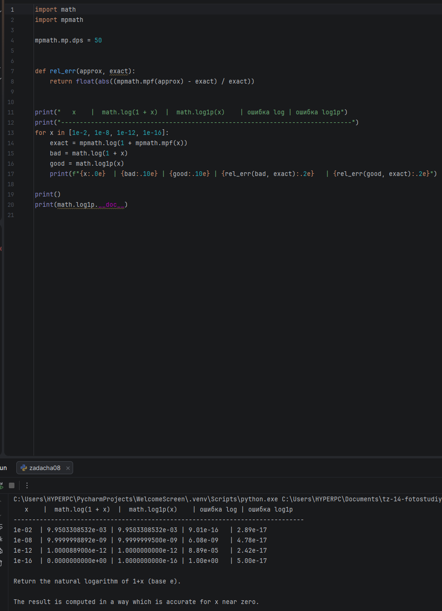

**Вывод.** `math.log(1 + x)` теряет точность уже при x = 10⁻⁸ (ошибка 6·10⁻⁹), при 10⁻¹² — 9·10⁻⁵, при 10⁻¹⁶ — 100 %, потому что 1 + x округляется до 1. `math.log1p(x)` по документации Python «вычисляется так, чтобы быть точным при x около нуля»: он не формирует 1 + x, поэтому малое x не теряется. Функции `log1p`, `expm1`, `hypot` есть в библиотеке именно для таких случаев, где прямая формула неустойчива.

### Задача 9. Накопление в сумме

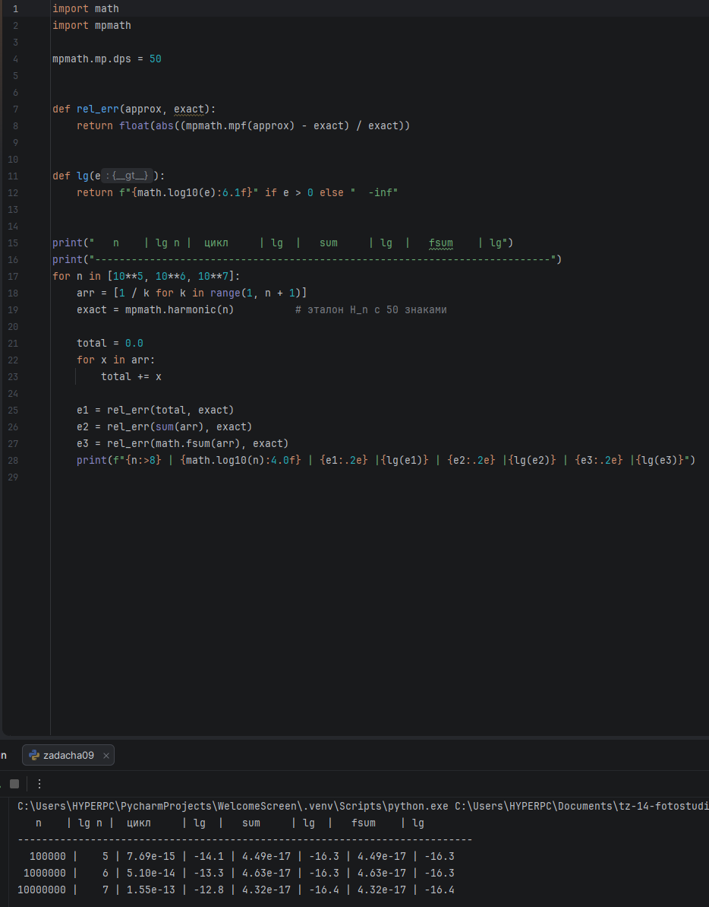

**Вывод.** Ошибка наивного цикла растёт с n: 7.7·10⁻¹⁵, 5.1·10⁻¹⁴, 1.6·10⁻¹³, примерно в 4–7 раз на каждый порядок n (наклон в log-log около 0.65). `sum` и `fsum` дали одинаковую ошибку около 4·10⁻¹⁷ (запуск на Python 3.14+). До порога 10⁻¹⁰ наивная сумма при n ≤ 10⁷ не дошла; если продлить наклон, порог будет около n ≈ 10¹¹.

---

## Блок 3. Корректная постановка эксперимента

### Задача 10. Разделение источников ошибки

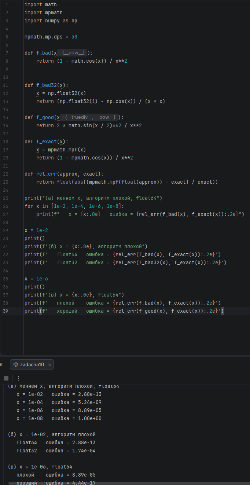

| Что меняем | Что фиксируем | Ошибка | Изменение |
|---|---|---|---|
| x: 10⁻² → 10⁻⁸ | плохой алгоритм, float64 | 3·10⁻¹³ → 1 | ≈ 13 порядков |
| float64 → float32 | x = 10⁻², плохой алгоритм | 3·10⁻¹³ → 2·10⁻⁴ | ≈ 9 порядков |
| плохой → хороший | x = 10⁻⁶, float64 | 9·10⁻⁵ → 4·10⁻¹⁷ | ≈ 12 порядков |

**Вывод.** В (а) доминирует сокращение при вычитании близких чисел, которое усиливается с уменьшением x. В (б) — машинная точность: у float32 всего ~7 значащих цифр. В (в) — устойчивость алгоритма: смена формулы при том же x и том же типе убирает 12 порядков ошибки.

### Задача 11. Эталон обязателен

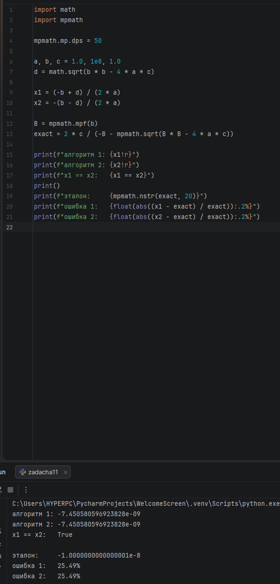

**Вывод.** Две записи меньшего корня x² + 10⁸x + 1 = 0 дают одинаковый float (`x1 == x2` → `True`), но обе ошибаются на 25 % относительно эталона. Совпадение двух float-результатов означает лишь, что они одинаково ошибаются, а не что они верны. Без независимого эталона эту ошибку не увидеть.

### Задача 12. Диапазон, а не одна точка

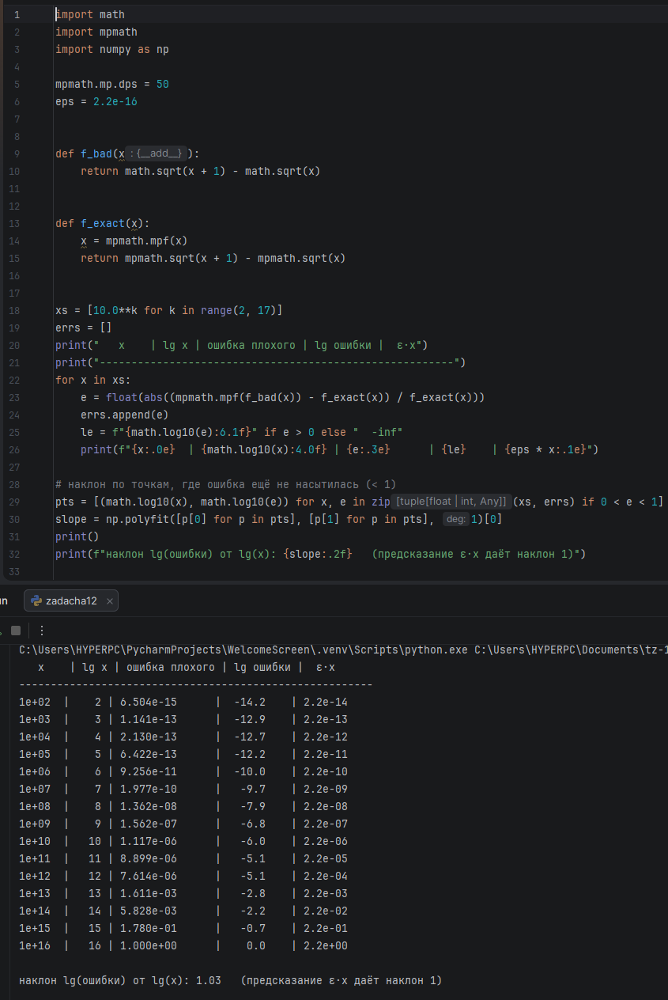

**Вывод.** На 15 точках от 10² до 10¹⁶ наклон lg(ошибки) от lg(x) равен 1.03, что совпадает с предсказанием ε·x (наклон 1); колонка ε·x в таблице держится рядом с фактической ошибкой. По одной точке нельзя отличить закономерность от случайности: например, при 10¹¹ и 10¹² ошибка почти одинаковая, и только диапазон показывает, что в целом она растёт пропорционально x.

### Задача 13. Воспроизводимость

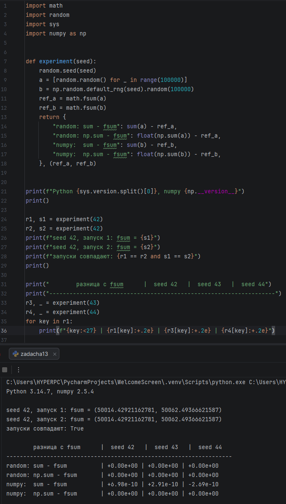

**Вывод.** Два запуска с seed 42 дали одинаковые результаты до последнего бита. На seed 42, 43, 44 картина одна и та же: для списка Python `sum` и `np.sum` совпадают с `fsum`, а `sum` по массиву numpy расходится с `fsum` на ~10⁻¹⁰ — значит, расхождение зависит от способа, а не от случайных данных. Версии (Python 3.14.7, numpy 2.5.4) указаны в выводе, потому что поведение `sum` зависит от версии: без seed и версий результат нельзя повторить.

### Задача 14. Границы представимости

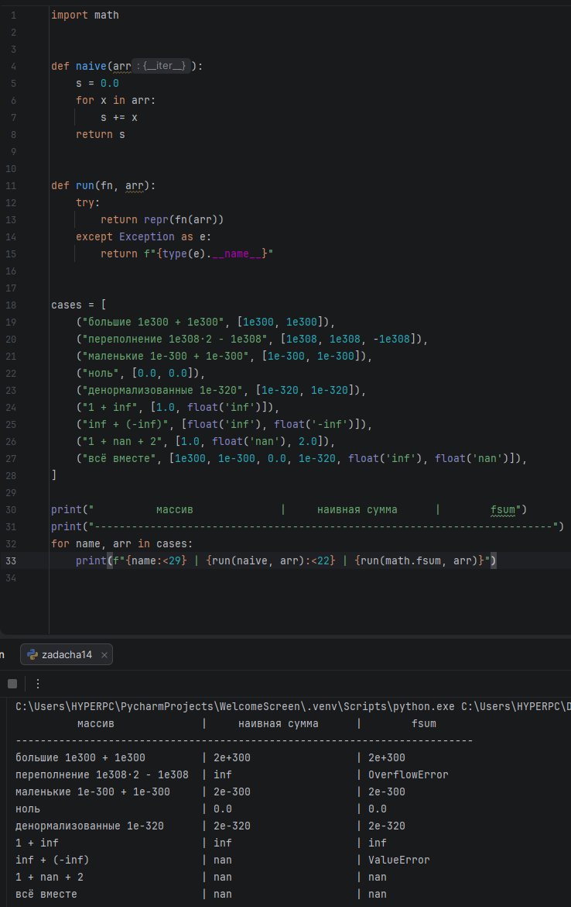

| Массив | Наивная сумма | fsum |
|---|---|---|
| 10³⁰⁰ + 10³⁰⁰ | 2e+300 | 2e+300 |
| 10³⁰⁸ + 10³⁰⁸ − 10³⁰⁸ | inf | OverflowError |
| 10⁻³⁰⁰ + 10⁻³⁰⁰ | 2e-300 | 2e-300 |
| 0 + 0 | 0.0 | 0.0 |
| 10⁻³²⁰ + 10⁻³²⁰ (денормализованные) | 2e-320 | 2e-320 |
| 1 + inf | inf | inf |
| inf + (−inf) | nan | ValueError |
| 1 + nan + 2 | nan | nan |
| всё вместе | nan | nan |

**Вывод.** Наивная сумма никогда не падает, но молча выдаёт `inf` или `nan`: NaN «отравляет» её сразу и до конца. `fsum` при переполнении и при inf − inf выбрасывает исключение, а с одним `inf` или `nan` возвращает `inf`/`nan`. В реальном коде после сумм и делений нужно проверять `math.isnan` / `math.isinf` и ловить исключения `fsum`.

### Задача 15. Полный эксперимент: ln(1 + x)

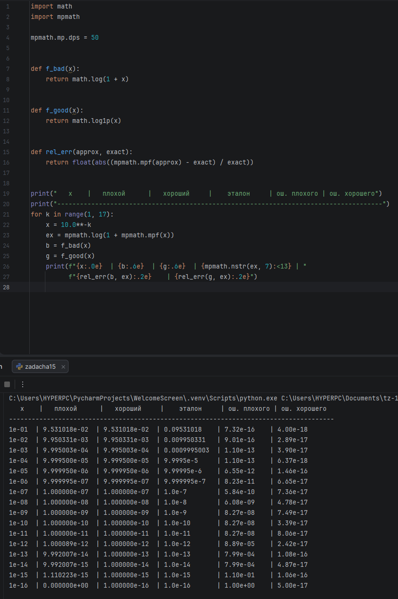

- **Цель:** проверить устойчивость двух способов вычисления ln(1 + x) при малых x.
- **Постановка:** плохой — `math.log(1 + x)`, хороший — `math.log1p(x)`. Меняется только x (16 точек, 10⁻¹ … 10⁻¹⁶), тип float64 фиксирован.
- **Эталон:** `mpmath.log(1 + x)` с 50 знаками.
- **Результаты:** таблица на скрине (вход, оба результата, эталон, обе ошибки).
- **Вывод:** плохой способ неустойчив, потому что формирует 1 + x и теряет младшие цифры x. Его ошибка растёт примерно как 10⁻¹⁶ / x: при x ≥ 10⁻⁴ она ≤ 10⁻¹³ (пригоден), при x = 10⁻¹² — уже 10⁻⁴, при x = 10⁻¹⁶ — 100 %. Хороший способ на всём диапазоне даёт ошибку около 10⁻¹⁶, то есть достижимая точность — машинная.
