NumPy: массивы, формы, типы данных и базовые операции, задачи 1–11

Задача 1. Инвентаризация массива

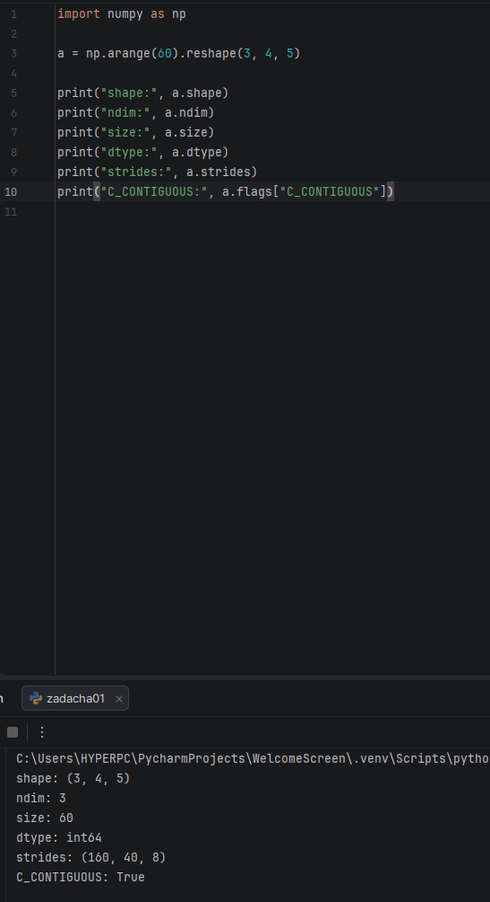

Вывод. shape (3, 4, 5), ndim 3, size 60, dtype int64, strides (160, 40, 8), массив C-contiguous. Элемент int64 занимает 8 байт: 8 — шаг к следующему элементу, 40 = 5 * 8 — шаг к следующей строке, 160 = 4 * 5 * 8 — шаг к следующему блоку 4 x 5. size = 3 * 4 * 5 = 60.

Задача 2. int и float — тихая ловушка

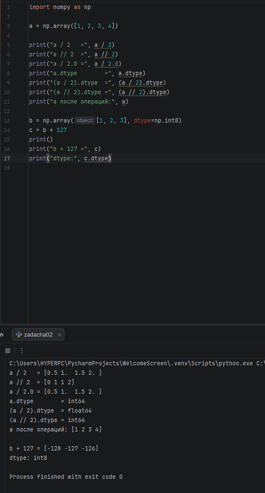

Вывод. a / 2 даёт новый массив float64, сам a остаётся int64 и не меняется. a // 2 остаётся int64. b + 127 в int8 даёт [-128 -127 -126]: int8 хранит только -128..127, и значения переполняются. NumPy не проверяет переполнение int и не падает, поэтому такую ошибку легко не заметить.

Задача 3. float32 и float64 — реальная точность

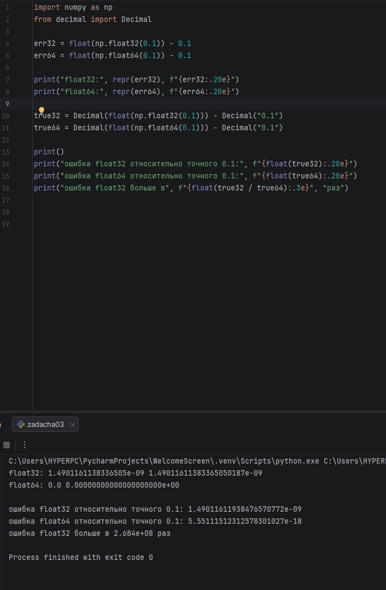

Вывод. float(np.float32(0.1)) - 0.1 = 1.49e-09, а float(np.float64(0.1)) - 0.1 = 0, потому что float64(0.1) и 0.1 в Python — одно и то же число. Поэтому настоящую ошибку считаем через Decimal относительно точного 0.1: у float32 1.49e-09, у float64 5.55e-18, то есть ошибка float32 больше примерно в 2.7 * 10^8 раз. float32 допустим, когда важнее память и скорость, а точность нужна грубая (изображения, нейросети). Для численных методов, где ошибка накапливается или вычитаются близкие числа, нужен float64.

Задача 4. Явный dtype при создании

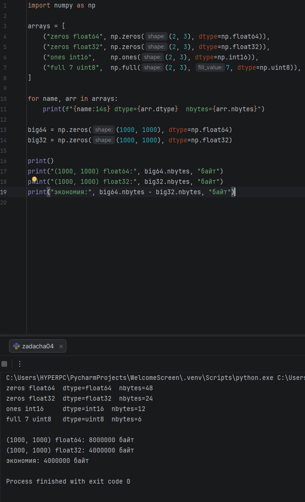

Вывод. Массив (2, 3) занимает: float64 — 48 байт, float32 — 24, int16 — 12, uint8 — 6. На массиве (1000, 1000) float32 экономит 4000000 байт, то есть половину памяти. Взамен точность падает до 7 значащих цифр вместо 15–16, поэтому по умолчанию берём float64.

Задача 5. Цепочка reshape

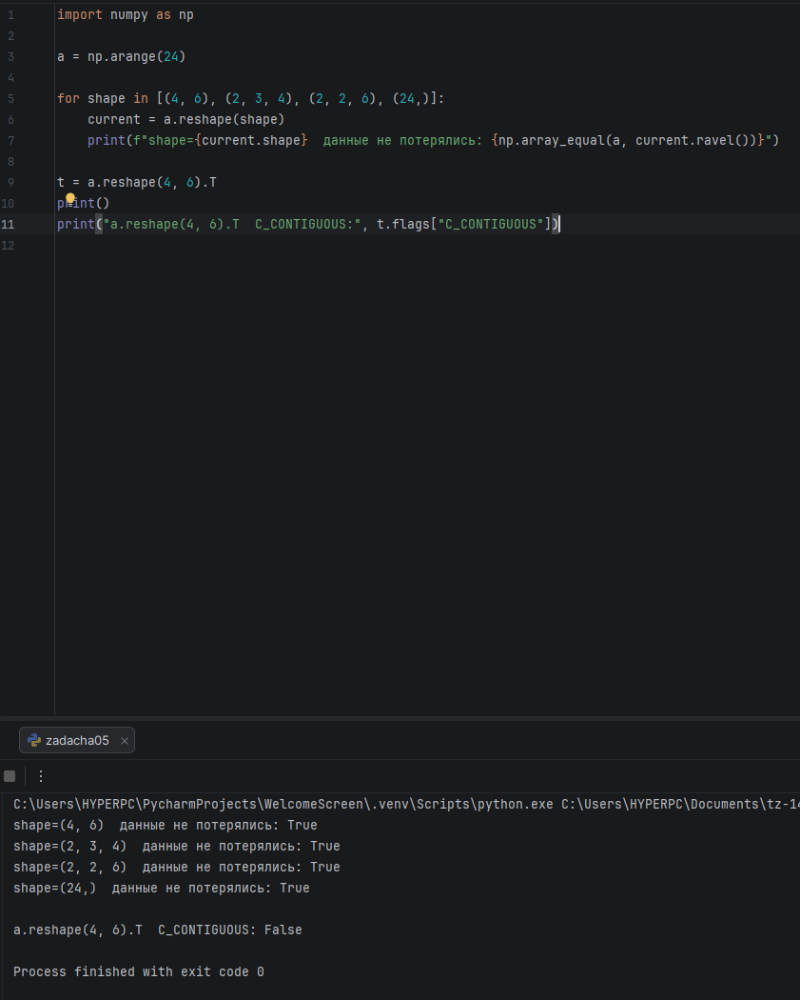

Вывод. На всех шагах np.array_equal даёт True — данные не потерялись. reshape обычно не копирует данные: элементы лежат в памяти подряд, меняются только shape и strides. Скопировать он вынужден, когда массив не C-contiguous, например после .T: порядок элементов в памяти не подходит новой форме.

Задача 6. flatten и ravel — копия или view

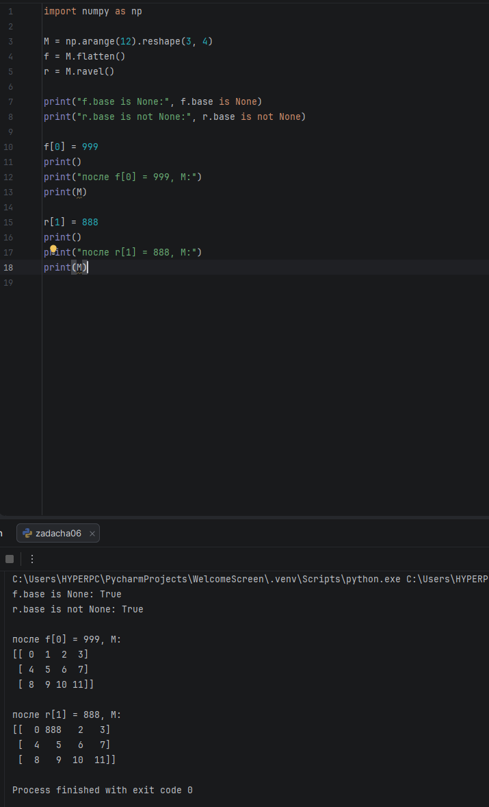

Вывод. flatten делает копию: f.base is None, и f[0] = 999 не меняет M. ravel возвращает view: r[1] = 888 изменил M. ravel подходит для больших массивов, когда данные только читаются, flatten — когда результат будем менять, а оригинал должен остаться целым.

Задача 7. newaxis, squeeze, транспонирование

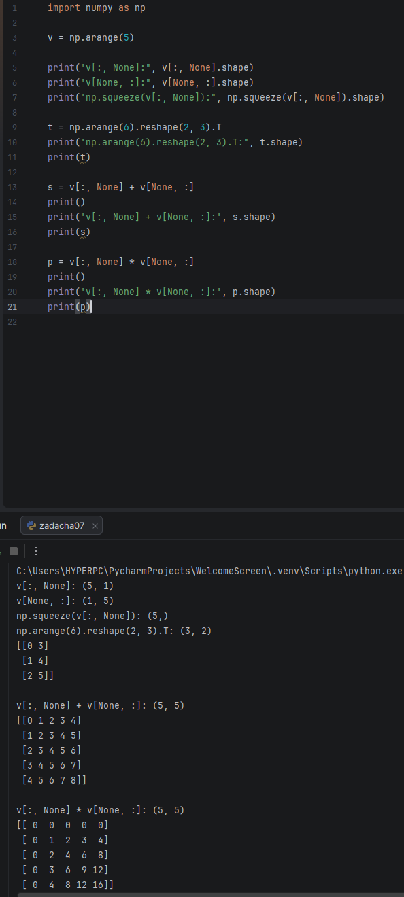

Вывод. v[:, None] — форма (5, 1), вектор стал столбцом. v[None, :] — форма (1, 5), вектор стал строкой. np.squeeze убирает ось длины 1 и возвращает (5,). .T у матрицы (2, 3) даёт (3, 2): строки стали столбцами. v[:, None] + v[None, :] через broadcasting даёт матрицу (5, 5) — таблицу сложения i + j, а с умножением получается таблица умножения i * j.

Задача 8. Транспонирование без копии

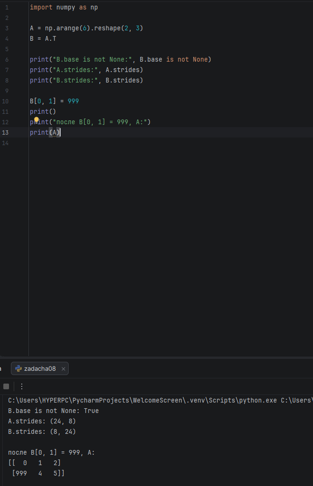

Вывод. B = A.T — view: после B[0, 1] = 999 изменился A[1, 0]. Данные не переставляются, меняются местами только strides: у A (24, 8), у B (8, 24), тот же буфер читается в другом порядке.

Задача 9. Поэлементное и матричное умножение

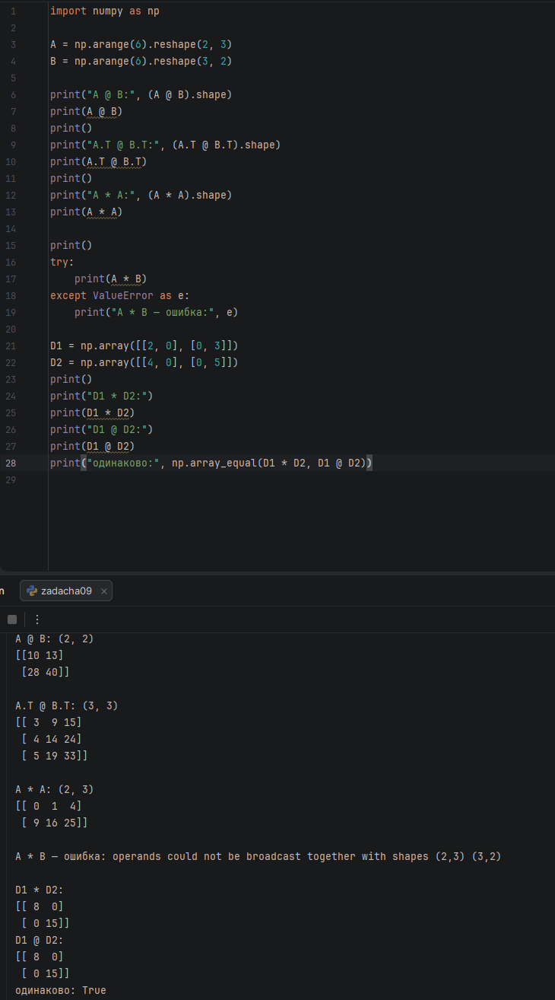

Вывод. A @ B даёт (2, 2), A.T @ B.T — (3, 3), A * A — (2, 3) с квадратами элементов. A * B даёт ошибку: * поэлементное, а формы (2, 3) и (3, 2) не согласуются. @ — матричное умножение, у него должны совпадать внутренние размеры. Для диагональных матриц * и @ дают одинаковый результат, потому что вне диагонали в обоих случаях нули.

Задача 10. axis=0 и axis=1

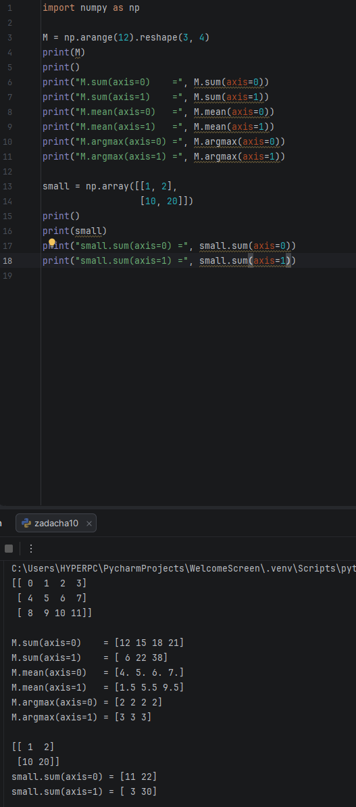

Вывод. axis=0 сворачивает строки: sum, mean и argmax считаются для каждого столбца. axis=1 сворачивает столбцы: результат для каждой строки. На маленьком примере [[1, 2], [10, 20]] sum(axis=0) = [11 22], то есть 1 + 10 и 2 + 20 — сумма по столбцам.

Задача 11. keepdims и broadcasting

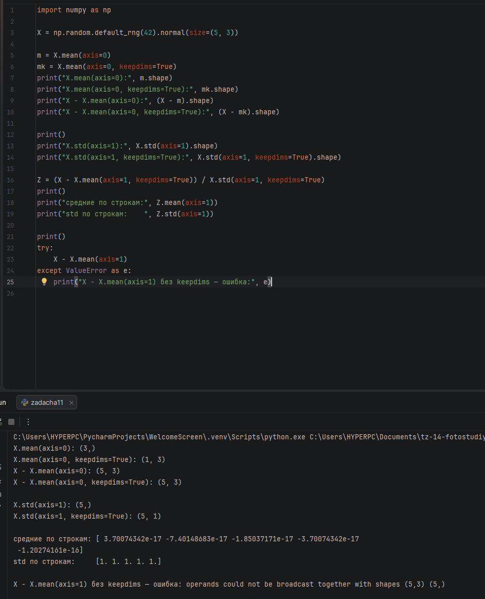

Вывод. X.mean(axis=0) имеет форму (3,), с keepdims — (1, 3), вычитание из X в обоих случаях даёт (5, 3). После нормировки строк средние по строкам около 0 (порядка 10^-17), std равны 1. Для строк keepdims нужен: без него среднее имеет форму (5,) и с (5, 3) не согласуется, а с keepdims форма (5, 1), и broadcasting растягивает его на все столбцы.
