# Циклы vs NumPy: задачи 1–11

## Блок 1. Основные операции

### Задача 1. Сумма массива

```python
def loop_sum(arr):          def numpy_sum(arr):
    total = 0.0                 return arr.sum()
    for x in arr:
        total += x
    return total
```

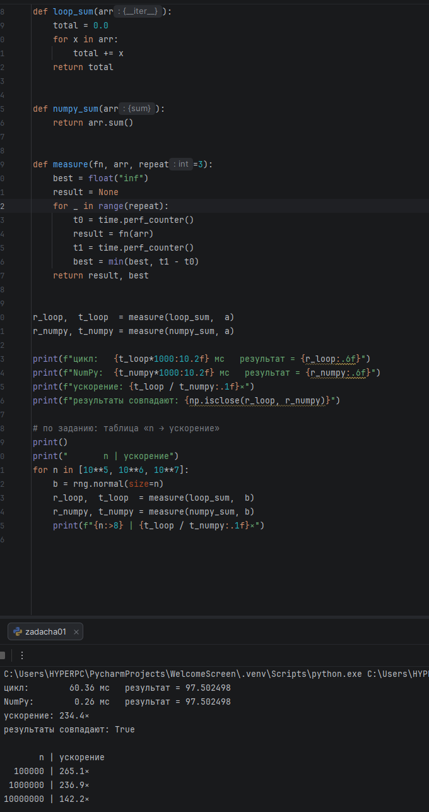

**Сравнение:** цикл 60.36 мс, NumPy 0.26 мс, ускорение 234×. По `n`: 10^5 — 265×, 10^6 — 237×, 10^7 — 142×. Строк кода: 4 / 1.

### Задача 2. Среднее и стандартное отклонение

```python
# цикл: сумма и сумма квадратов, затем std = sqrt(s2/n - mean^2)
return arr.mean(), arr.std()            # NumPy
```

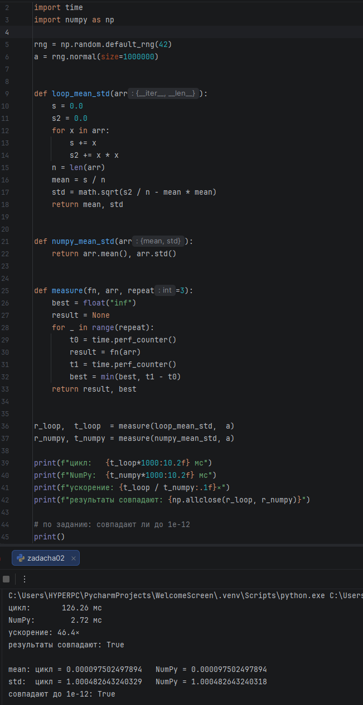

**Сравнение:** цикл 126.26 мс, NumPy 2.72 мс, ускорение 46×. Совпадают до `1e-12`. Строк кода: 9 / 1.

### Задача 3. y = sin(x) + x²

```python
for x in arr:                                 # цикл
    result.append(math.sin(x) + x * x)
np.sin(arr) + arr**2                          # NumPy
```

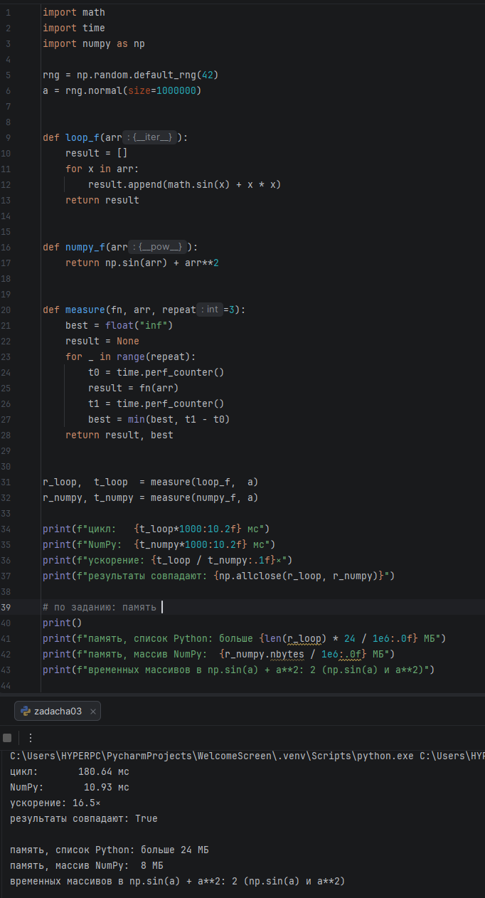

**Сравнение:** цикл 180.64 мс, NumPy 10.93 мс, ускорение 16.5×. Память: список больше 24 МБ, массив 8 МБ, временных массивов 2. Строк кода: 4 / 1.

### Задача 4. Условная замена (clip)

```python
for x in arr:                  # цикл
    if x < 0: ...
    elif x > 1: ...
    else: ...
np.clip(arr, 0, 1)             # NumPy
```

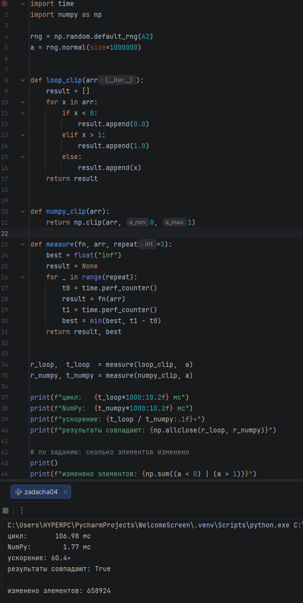

**Сравнение:** цикл 106.98 мс, NumPy 1.77 мс, ускорение 60×. Изменено 658 924 элемента. Строк кода: 9 / 1 (1 `for` и 2 `if` / 0 и 0).

---

## Блок 2. Агрегации по осям

### Задача 5. Сумма по строкам матрицы

```python
for i in range(mat.shape[0]):           # цикл
    s = 0.0
    for j in range(mat.shape[1]):
        s += mat[i, j]
    result[i] = s
mat.sum(axis=1)                         # NumPy
```

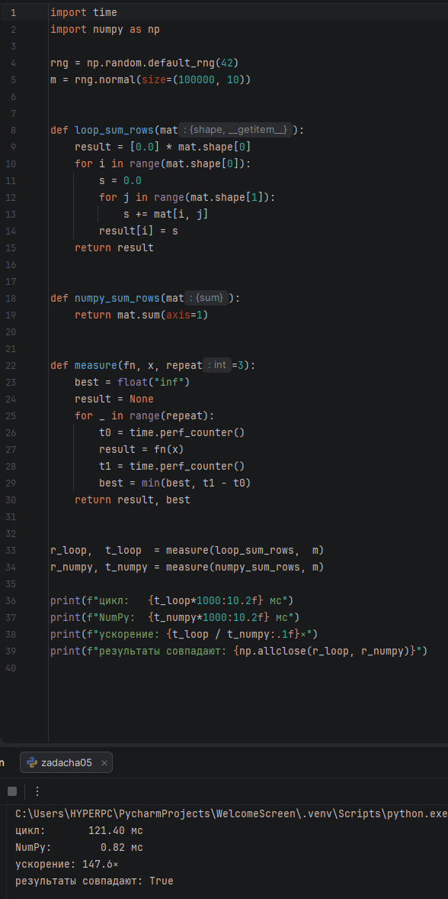

**Сравнение:** цикл 121.40 мс, NumPy 0.82 мс, ускорение 148×. Строк кода: 7 / 1.

### Задача 6. Среднее по столбцам и нормировка

```python
# цикл: вложенные циклы по j и i, обращения mat[i, j]
mat - mat.mean(axis=0)                  # NumPy
```

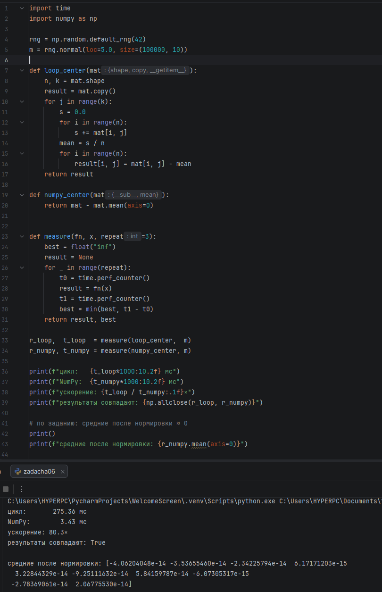

**Сравнение:** цикл 275.36 мс, NumPy 3.43 мс, ускорение 80×. Средние после нормировки ≈ 0. Строк кода: 10 / 1.

### Задача 7. Максимум и его индекс

```python
for i in range(1, len(arr)):            # цикл
    if arr[i] > max_val: ...
arr.max(), arr.argmax()                 # NumPy
```

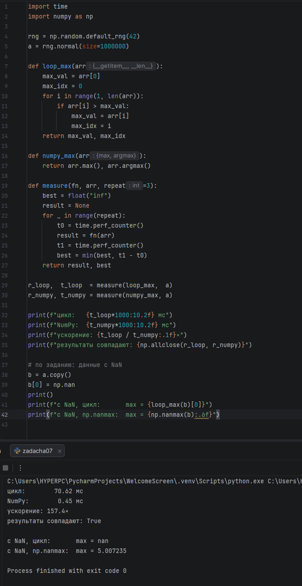

**Сравнение:** цикл 70.62 мс, NumPy 0.45 мс, ускорение 157×. С NaN: цикл — `nan`, `np.nanmax` — 5.007235. Строк кода: 7 / 1.

---

## Блок 3. Фильтрация и маски

### Задача 8. Фильтрация по порогу

```python
[x for x in arr if x > 0]               # цикл → list
arr[arr > 0]                            # NumPy → ndarray
```

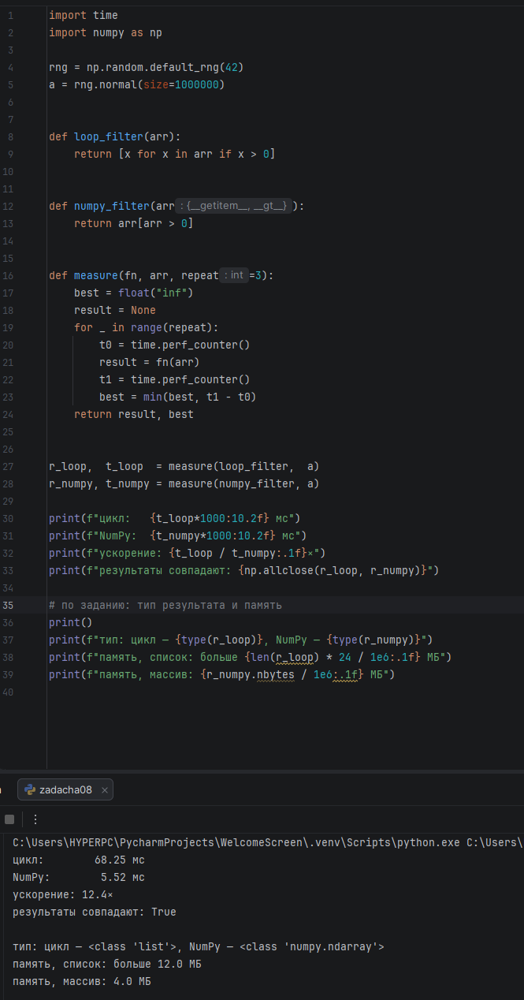

**Сравнение:** цикл 68.25 мс, NumPy 5.52 мс, ускорение 12×. Память: список больше 12 МБ, массив 4 МБ. Строк кода: 1 / 1.

### Задача 9. Замена по маске in-place

```python
for i in range(len(arr)):               # цикл
    if arr[i] < 0:
        arr[i] = -arr[i]
np.abs(arr, out=arr)                    # NumPy
```

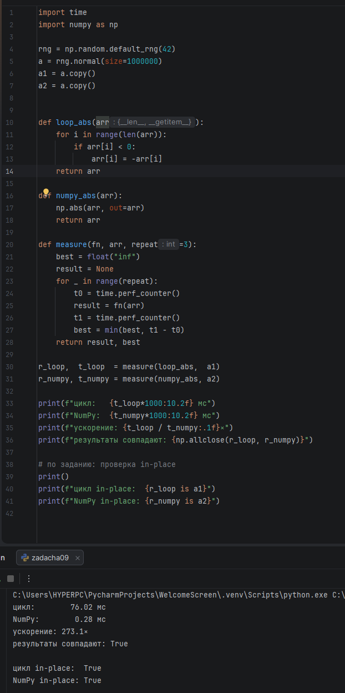

**Сравнение:** цикл 76.02 мс, NumPy 0.28 мс, ускорение 273×. Оба варианта in-place. Строк кода: 4 / 2.

### Задача 10. Комбинированная маска

```python
[x for x in arr if -1 < x < 1]          # цикл
arr[(arr > -1) & (arr < 1)]             # NumPy
```

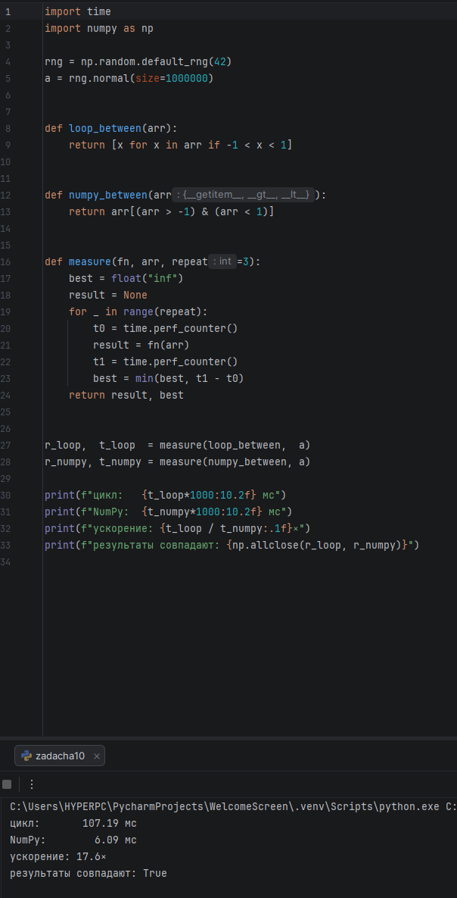

**Сравнение:** цикл 107.19 мс, NumPy 6.09 мс, ускорение 18×. Строк кода: 1 / 1.

---

## Блок 4. Реальные кейсы

### Задача 11. Расстояния между точками

```python
for i in range(X.shape[0]):             # цикл
    for j in range(Y.shape[0]):
        D[i, j] = math.sqrt(...)
np.sqrt(((X[:, None, :] - Y[None, :, :])**2).sum(axis=2))   # NumPy
```

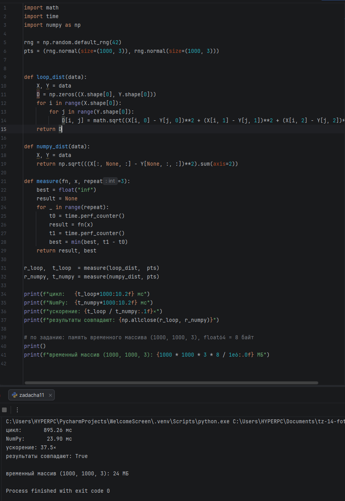

**Сравнение:** цикл 895.26 мс, NumPy 23.90 мс, ускорение 37.5×. Временный массив `(1000, 1000, 3)` — 24 МБ. Строк кода: 6 / 2.

---

## Итог

| Задача | Цикл, мс | NumPy, мс | Ускорение | Строк кода (цикл / NumPy) |
|---|---|---|---|---|
| 1. Сумма | 60.36 | 0.26 | 234× | 4 / 1 |
| 2. mean и std | 126.26 | 2.72 | 46× | 9 / 1 |
| 3. sin(x) + x² | 180.64 | 10.93 | 16.5× | 4 / 1 |
| 4. clip | 106.98 | 1.77 | 60× | 9 / 1 |
| 5. Сумма по строкам | 121.40 | 0.82 | 148× | 7 / 1 |
| 6. Нормировка | 275.36 | 3.43 | 80× | 10 / 1 |
| 7. Максимум | 70.62 | 0.45 | 157× | 7 / 1 |
| 8. Фильтрация | 68.25 | 5.52 | 12× | 1 / 1 |
| 9. In-place | 76.02 | 0.28 | 273× | 4 / 2 |
| 10. Двойная маска | 107.19 | 6.09 | 18× | 1 / 1 |
| 11. Расстояния | 895.26 | 23.90 | 37.5× | 6 / 2 |
