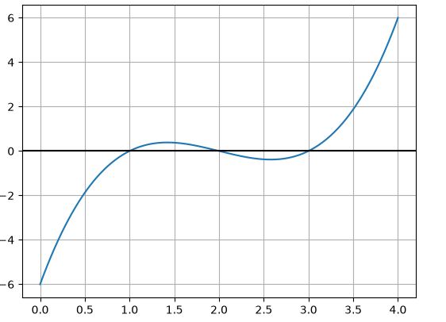
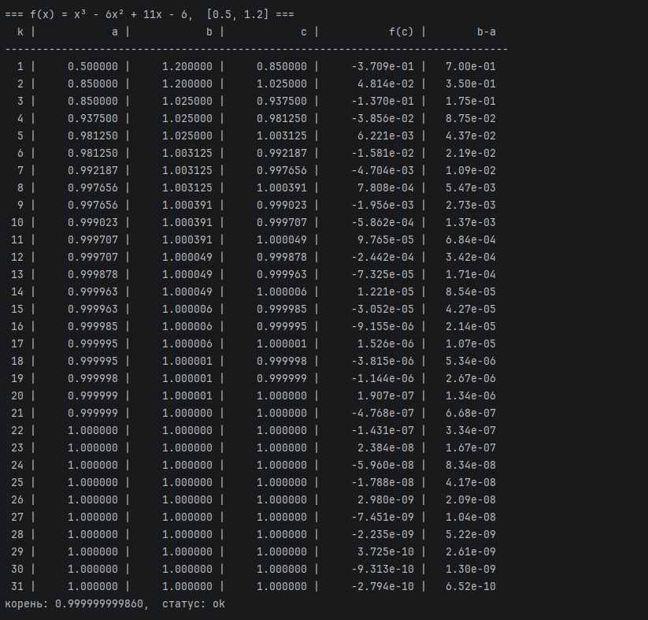
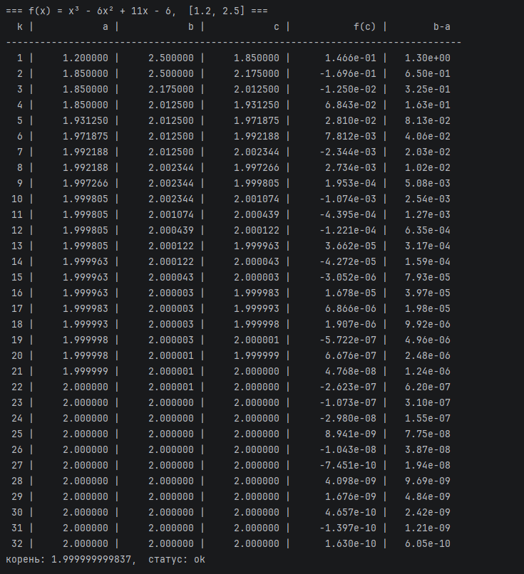
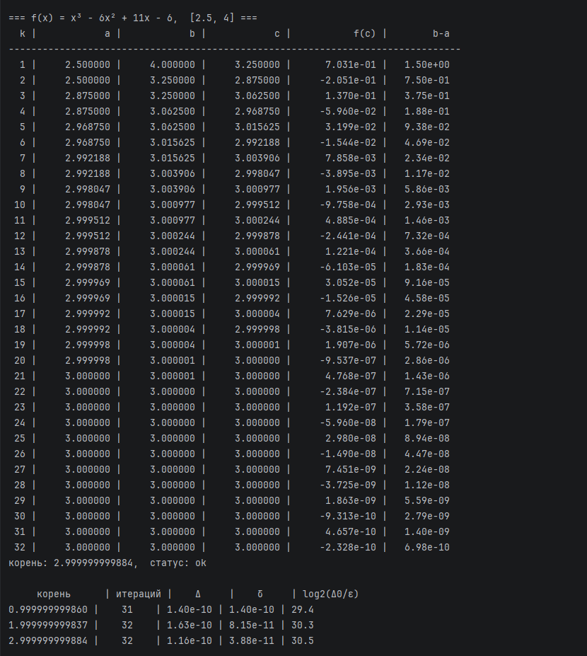

## Задача 1. Найти все корни полинома на заданном отрезке
Условие. Дана функция f(x) = x³ − 6x² + 11x − 6. Известно, что у неё три корня: x = 1, 2, 3.
1. Постройте график f(x) на отрезке [0, 4] и визуально определите интервалы, содержащие каждый корень.
2. Для каждого интервала примените bisection с точностью ε = 10−9.
3. Выведите журнал для каждого корня (три таблицы).
4. Сравните число итераций для трёх корней. Объясните, почему они могут отличаться (подсказка: длина стартового интервала).
5. Найдите корни аналитически (разложите полином на множители) и сравните с численным результатом. Оцените абсолютную и относительную погрешность.

**Что сдать:** скрипт, три журнала, график, таблица «корень → число итераций → Δ → δ», и вывод о том, совпадает ли число итераций с теоретической оценкой log2(Δ0 / ε).

[0.5 - 1.2] - интервал первого корня

[1.2 - 2.5] - интервал второго корня

[2.5 - 4] - интервал третьего корня

