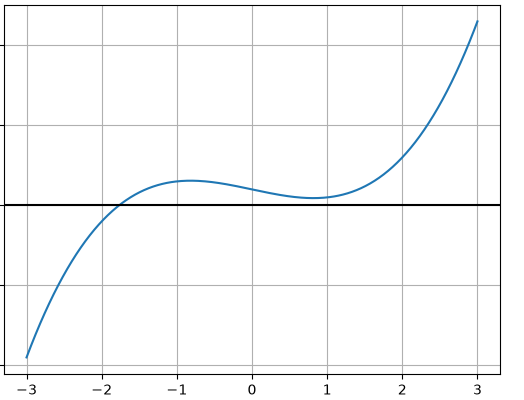

## Задача 1. Сравнить методы на функции с плохим стартом
Условие. Дана функция f(x) = x³ − 2x + 2. У неё один действительный корень (около −1.769).
1. Постройте график на [−3, 3]. Убедитесь, что корень один.
2. Запустите метод Ньютона с x0 = 0. Что происходит? Почему метод не сходится? (Подсказка: постройте журнал и посмотрите на f′(xk).)
3. Запустите метод Ньютона с x0 = −2. Сколько итераций?
4. Запустите метод секущих с x0 = −2, x1 = −1. Сколько итераций?
5. Запустите бисекцию на [−2, −1]. Сколько итераций?
6. Постройте таблицу: метод → старт → корень → итераций. Объясните, почему метод Ньютона с x0 = 0 «застревает».

**Что сдать:** скрипт, график, журналы, таблица, вывод о том, как выбор начального приближения влияет на сходимость.

Журналы Ньютона (x0 = 0, x0 = −2), секущих (x0 = −2, x1 = −1) и итоговая таблица

Пояснения

По графику функция пересекает ось X один раз, около x = −1.77, так что действительный корень один.

Метод Ньютона с x0 = 0 не сходится: по журналу x прыгает между 0 и 1 по кругу. В точке 0 f(0) = 2, f′(0) = −2, и следующий шаг x = 0 − 2/(−2) = 1. В точке 1 f(1) = 1, f′(1) = 1, и следующий шаг x = 1 − 1/1 = 0. Касательная из каждой точки ведёт в другую, метод зацикливается и останавливается только по лимиту итераций (статус max_iter).

Метод Ньютона с x0 = −2 нашёл корень −1.769292354239 за 5 итераций, секущие с x0 = −2, x1 = −1 — за 9, бисекция на [−2, −1] — за 41.

Вывод: Ньютон самый быстрый, но только при хорошем начальном приближении. Стоит начать рядом с корнем (x0 = −2), и он сходится за 5 шагов, а с неудачного старта (x0 = 0) не сходится вовсе. Бисекция медленнее всех, зато сходится всегда, если на концах интервала есть смена знака.
