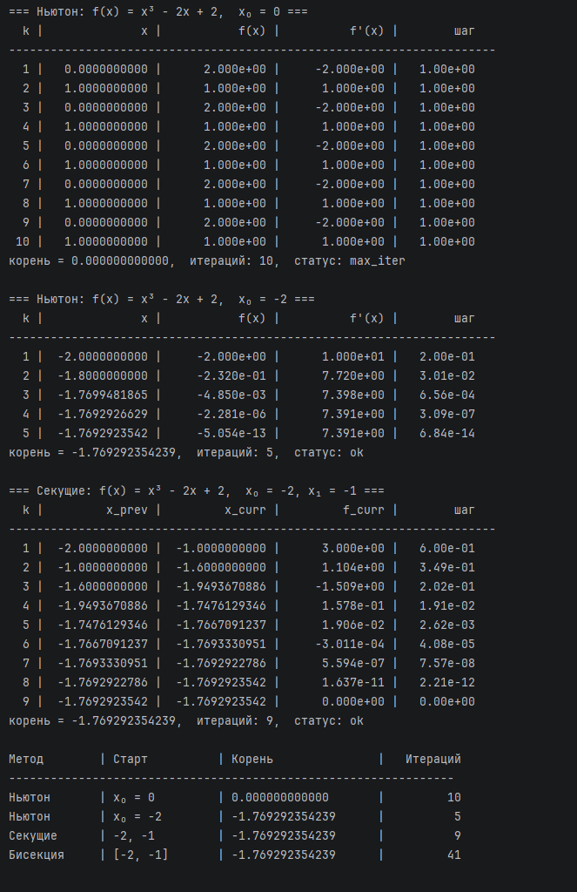

## Задача 1. Сравнить методы на функции с плохим стартом
Условие. Дана функция f(x) = x³ − 2x + 2. У неё один действительный корень (около −1.769).
1. Постройте график на [−3, 3]. Убедитесь, что корень один.
2. Запустите метод Ньютона с x0 = 0. Что происходит? Почему метод не сходится? (Подсказка: постройте журнал и посмотрите на f′(xk).)
3. Запустите метод Ньютона с x0 = −2. Сколько итераций?
4. Запустите метод секущих с x0 = −2, x1 = −1. Сколько итераций?
5. Запустите бисекцию на [−2, −1]. Сколько итераций?
6. Постройте таблицу: метод → старт → корень → итераций. Объясните, почему метод Ньютона с x0 = 0 «застревает».

**Что сдать:** скрипт, график, журналы, таблица, вывод о том, как выбор начального приближения влияет на сходимость.

Журналы Ньютона (x0 = 0, x0 = −2), секущих (x0 = −2, x1 = −1) и итоговая таблица

